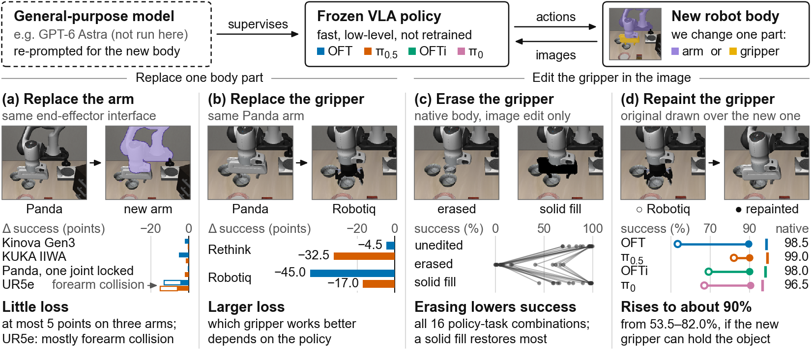

# Change the Arm, Mind the Gripper: Reusing Frozen VLA Policies on a New Robot Body

[Project page](https://cicici-shi.github.io/mind-the-gripper/) | [Paper](https://cicici-shi.github.io/mind-the-gripper/paper.pdf) | [License: MIT](LICENSE)



*A general-purpose model moves to a new robot body by changing its prompt and supervises a fast, frozen VLA policy; we evaluate the policy alone, in simulation, and change one part of the body at a time.*

Code and raw readouts for the CS5478 course project of the same name. We test six frozen public VLA policies:
OpenVLA-OFT with its joint LIBERO checkpoint (OFT) and with its suite-specific checkpoints (OFTi), π0.5 and π0 on
LIBERO, and open-pi-zero and CogACT on SimplerEnv. We change the robot body in LIBERO (robosuite / MuJoCo) one
component at a time (the arm: KUKA IIWA, Kinova Gen3, UR5e, Panda with one joint locked; the gripper: Rethink, Robotiq
2F-85 with a soft-finger and a stiff-finger actuator setting). We repaint the Panda gripper into the camera image with
a synchronized twin render, and we edit only the image on the native body (erasure, solid fill, contour, lagged
contour, shifted contour, edits only before or only after the first gripper closure).

All experiments ran on a SLURM GPU cluster. The scripts are the versions that produced the numbers in the paper. They
were not rewritten to run elsewhere, so cluster paths, conda environment names and GPU types in the `sbatch` files
must be adapted (see [Running on another machine](#running-on-another-machine)).

System requirements: one GPU per job. The `sbatch` files request `a100-40`, `a100-80`, `h100-47` (a MIG slice),
`h100-96`, `h200-141` and `gpu:nv` (noted in the contour-shift jobs as a 24 GB Titan RTX).

## Main results

Changes are in percentage points of success rate, 200 paired episodes per cell, on LIBERO-Spatial unless noted.

| Change | Result | Paper | Raw readout (`results/`) |
|---|---|---|---|
| Arm swap: Kinova Gen3, KUKA IIWA, Panda with one joint locked | at most 5.0 points for both OFT and π0.5 | Section 4.1 | `4.1_body_swap/results_block3_final.txt` |
| Arm swap: UR5e | OFT -13.0, π0.5 -15.0, mostly from a forearm collision with a cabinet; -4.0 and -6.0 with forearm collision disabled | Section 4.1 | `4.1_body_swap/results_block3_final.txt` |
| Gripper swap: Rethink / stiff-finger Robotiq 2F-85* | Rethink: OFT -4.5, π0.5 -32.5; stiff Robotiq: OFT -45.0, π0.5 -17.0 | Section 4.1 | `4.1_body_swap/results_block3_final.txt` |
| Erase the gripper from the image (native body) | success drops in all 16 policy-task combinations, by 27.0 to 99.0 points | Section 4.2, Table 2 | `4.2_image_edits/` |
| Repaint the Panda gripper over the stiff Robotiq* | four policies rise from 53.5% to 82.0% success to 89.5% to 90.5%, against 96.5% to 99.0% on the native body | Section 4.1 | `4.1_body_swap/results_block3_final.txt` (OFT, π0.5), `results_models1.txt` (OFTi, π0) |

\* In the stiff-finger Robotiq setting the fingers interpenetrate when closed, so these rows hold only for that
configuration.

## Repository layout

```
embody/              LIBERO environment wrapper, latest snapshot (2026-11-12): body swap, twin render,
                     image edits (maskinfo*.py), phase gate (phasegate.py)
envs/embody_v3/      environment snapshot frozen 2026-10-31, used for the arm / gripper swaps of Section 4.1
envs/embody_next/    environment snapshot used for the Robotiq soft-finger and physics-fix runs of Section 4.1
eval/libero/         shared LIBERO entry points (OpenVLA-OFT script, openpi client and fixed-noise server)
eval/4.1_body_swap/  ... eval/4.5_failure_analysis/   launchers, sbatch files and section-specific scripts
analysis/            preregistered readout scripts (with their tests) and the figure script
results/             raw readout text files behind every number in the paper, by section
```

### Which environment snapshot belongs to which experiment

Each batch of experiments ran with its own frozen copy of the `embody` package (selected with `EMBODY_DIR`). The
snapshots are kept as they were run; they were not merged.

| Snapshot | Experiments | Paper |
|---|---|---|
| `envs/embody_v3/embody` | arm swaps (IIWA, Kinova Gen3, UR5e with and without forearm collision, Panda with a locked joint), Rethink gripper, stiff-finger Robotiq (`GRP_KP=100`), twin repaint in both or one camera, Robotiq appearance on Panda physics (`G_R`), LIBERO-Object block; OFT and π0.5. The earlier block-1/2 code (`embody`, `embody_dev`) was merged into this snapshot with a regression check: with the environment variables of an earlier run the code path is unchanged (see the module docstring of `body_env.py`, `COPY_GRIP_CMD`) | 4.1 |
| `envs/embody_next/embody` | physics-fix runs: soft-finger Robotiq (`kp20`), rescue pilot, LIBERO-Object rerun after the simulation fault was fixed | 4.1 |
| `embody/` (latest) | OFTi and π0 body-swap cells (models1) and the 100-key toy1 cells (gripper hidden, single-camera erasure) were run with `embody_toy`; LIBERO image edits (maskinfo, maskinfo-π, maskinfo-confirm) and phase-gated edits. `embody/` is `embody_toy` plus additive switches only (`maskinfo.py`, `maskinfo_pi.py`, `phasegate.py`, extra `PG_*` / `MI_*` branches in `body_env.py`); with those switches unset it follows the `embody_toy` path | 4.1 (toy1, models1), 4.2, 4.4, 4.5 |

The Robotiq and Rethink bodies need a free-air calibration table `gripper_calib.npz` next to `body_env.py` (or set
`GRIPPER_CALIB`). The table used in the paper is included in each `embody` snapshot; it can be regenerated with
`eval/4.1_body_swap/block3_embody_v3/calib_grippers.py` (see its header).

## Dependencies

Versions are those recorded in the install scripts and notes; anything not listed there is not pinned here.

LIBERO side
- LIBERO from [LIBERO-Plus](https://github.com/sylvestf/LIBERO-plus) (the original 10 LIBERO-Spatial / Object tasks are
  rebuilt from its bddl and init files by `embody/original.py`); see also the original
  [LIBERO](https://github.com/Lifelong-Robot-Learning/LIBERO).
- [robosuite](https://github.com/ARISE-Initiative/robosuite) 1.4.1 and MuJoCo 2.3.2 (MuJoCo 3.x does not work with
  robosuite 1.4.1). Rendering uses EGL (`MUJOCO_GL=egl`); robosuite's EGL context was patched to use `mujoco.egl`.
- [OpenVLA-OFT](https://github.com/moojink/openvla-oft) with the checkpoints
  `moojink/openvla-7b-oft-finetuned-libero-spatial-object-goal-10` (OFT) and
  `moojink/openvla-7b-oft-finetuned-libero-spatial` / `-libero-object` (OFTi).
- [openpi](https://github.com/Physical-Intelligence/openpi) (commit `215abfb`, see `eval/4.1_body_swap/pi05/README.md`)
  with the `pi05_libero` and `pi0_libero` checkpoints, plus `openpi-client` in the LIBERO environment.

SimplerEnv side
- [SimplerEnv](https://github.com/simpler-env/SimplerEnv) with `ManiSkill2_real2sim` (CogACT runs), and the SimplerEnv
  fork used by open-pi-zero (open-pi-zero runs); Python 3.10, `numpy==1.24.4`.
- [open-pi-zero](https://github.com/allenzren/open-pi-zero) with `bridge_beta_step19296_2024-12-26_22-30_42.pt` and
  `fractal_beta_step29576_2024-12-29_13-10_42.pt`; torch 2.5.0 (`eval/4.2_image_edits/simpler_open_pi_zero/install_pi0.sbatch`).
- [CogACT](https://github.com/microsoft/CogACT) with `CogACT/CogACT-Base`; torch 2.3.1
  (`eval/4.2_image_edits/simpler_cogact/install_env.sbatch`). The Llama-2 tokenizer is gated on Hugging Face; see
  `make_llama_stub.py` for how it was obtained.

## Paper sections, scripts and readouts

| Paper | What | Entry points and launchers | Readout script | Raw readout (`results/`) |
|---|---|---|---|---|
| 4.1 | Arm swaps, Rethink, stiff Robotiq, twin repaint, per-camera repaint, `G_R`; OFT and π0.5, Spatial and Object | OFT: `eval/libero/oft/run_libero_eval_toy.py` (see note 1) via `eval/4.1_body_swap/run_cond.sbatch`, `block3_embody_v3/run_cond_multi.sbatch`, `run_cond_object.sbatch`; π0.5: `eval/4.1_body_swap/pi05/pi05_body_eval.py` via `run_pi05_v2.sbatch`, `block3_embody_v3/run_pi05_multi.sbatch`, `run_pi05_object.sbatch`; submit list `block3_embody_v3/LAUNCH_block3.md` | `analysis/body_swap/block2/prereg_block2.py`, `prereg_block2_cg.py`; `analysis/body_swap/block3/prereg_block3.py`, `prereg_block3_a2.py`, `prereg_block3_a2_sens.py` | `4.1_body_swap/results_block2_final.txt`, `results_block2_cg.txt`, `results_block3_final.txt`, `results_block3_literal.txt`, `results_block3_object.txt`, `results_block3_object_sens_physics.txt` |
| 4.1 | OFTi and π0 on the stiff Robotiq, repaint, per-camera repaint | `eval/4.1_body_swap/models1_vla_zoo/` (`oft/run_libero_eval_m1.py`, `common/zoo_client.py`, `common/zoo_server.py`, `tools/m1_driver.py`) | `analysis/body_swap/models1_physfix/prereg_models1.py`, `prereg_models1_sens.py` | `results_models1.txt`, `results_models1_sens_physics.txt`, `verdict_models1*.json` |
| 4.1 | Soft-finger Robotiq, Rethink travel fix, Object rerun after the simulation fault; rescue pilot (soft Robotiq + repaint) | `eval/4.1_body_swap/physfix_embody_next/` (`pf/run_oft_pf.sbatch`, `pf/launch_pf.py`, `pf/submit_pf.sh`, scripted grasp checks `pf/geo_grasp_pf.py`, `pf/grasp_plaus_pf.py`); `eval/4.1_body_swap/rescue/submit_rescue.sh` | `analysis/body_swap/models1_physfix/prereg_physfix.py`; `analysis/body_swap/rescue/readout_rescue.py` | `results_physfix.txt`, `verdict_physfix.json`, `results_rescue_pilot.txt` |
| 4.1, 4.2 | toy1: 100-key OFT cells incl. gripper hidden on Robotiq and on Panda, single-camera erasure | `eval/4.1_body_swap/toy1_embody_toy/` (`submit_toy_formal.sh`, `toy_cells.sh`, `run_toy_multi.sbatch`) | `analysis/body_swap/toy1/prereg_toy1.py` | `results_toy1.txt`, `verdict_toy1.json` |
| 4.2 | LIBERO image edits (cells C0 to C7), OFT / OFTi | `eval/libero/oft/run_libero_eval_pg.py` with `MI_CELL`; `eval/4.2_image_edits/libero/oft/` (`mi_cells.sh`, `mi_cells_run_c.sbatch`, `submit_mi_confirm.sh`) | `analysis/image_edits/prereg_maskinfo.py`, `prereg_maskinfo_confirm.py` | `4.2_image_edits/libero/results_maskinfo.txt`, `results_maskinfo_confirm.txt`, `verdict_maskinfo.json` |
| 4.2 | LIBERO image edits, π0.5 / π0 | `eval/libero/pi/zoo_client_pg.py` with `MI_CELL`, server `eval/libero/pi/serve_policy_mi.py`; `eval/4.2_image_edits/libero/pi/` (`mi_pi_run.sbatch`, `mi_pi_params.sh`, `submit_mi_pi_formal.sh`) | `analysis/image_edits/prereg_maskinfo_pi.py`; gate amendment `eval/4.2_image_edits/libero/pi/readout/` | `results_maskinfo_pi.txt`, `verdict_maskinfo_pi.json` |
| 4.2 | SimplerEnv image edits, open-pi-zero (B1 eggplant, B2 spoon, F1 coke can, F2 move near); light fill and lag | `eval/4.2_image_edits/simpler_open_pi_zero/b2/` (`eval_views.py`, `views.py`, `submit_formal.sh`), extension `b2x/` | `b2/readout.py`, `b2x/readout.py` | `4.2_image_edits/simpler_open_pi_zero/READOUT_bench2_*.txt`, `READOUT_bench2_ext_*.txt`, `REPORT_bench2_ext_readout_2026-11-13.md` |
| 4.2 | SimplerEnv image edits, CogACT | `eval/4.2_image_edits/simpler_cogact/b2c/` (`eval_views.py`, `views.py`, `submit_formal.sh`) | `b2c/readout.py` | `4.2_image_edits/simpler_cogact/READOUT_bench2_cogact_*.txt`; cross-model summary `REPORT_usage_boundary_zero_cost_2026-11-17.md` |
| 4.3 | Contour shifted by ±6 / ±12 / ±24 px, controls (unshifted + shifted, object shift); open-pi-zero on WidowX | `eval/4.3_contour_shift/b3/` (`eval_views.py`, `views.py`, `cue_spec.py`, `submit_cue.sh`, `jobs/cue2.sbatch`, frozen inputs `*_v31.json`, `keysets/`); exploratory `localq*.py`, `q1check/` | `b3/cue_readout.py` (and `cue_gate.py`) | `4.3_contour_shift/READOUT_cue_widowx_v3_1_2026-11-15.txt` |
| 4.4 | Robotiq appearance or erasure only before / only after the first closure; OFT and OFTi, Spatial | `eval/libero/oft/run_libero_eval_pg.py` with `PG_MODE` / `PG_WINDOW`; `eval/4.4_phase_gate/pg_run.sbatch` (`pg_pi_run.sbatch` for the π family); notes `NOTES_phasegate_zh.md` | `analysis/phase_gate/pg_confirm.py` | `4.4_phase_gate/results_phasegate_confirm.txt` |
| 4.5 | Post-hoc failure patterns: closure counts, steps, distance at closure | SimplerEnv: `eval/4.5_failure_analysis/simpler_open_pi_zero/` (`summarize.py`, `replay/replay.py`, `replay_summary.py`), `simpler_cogact/` (`replay_cogact.py`, `cogact_summary.py`); LIBERO: `libero_oft/manip_summary.py`, `libero_pi/manip_summary_pi.py` | same | `4.5_failure_analysis/REPORT_bench2_step0_2026-11-13.md`, `REPORT_cogact_replay_2026-11-17.md`, `simpler_*/*tables.txt`; LIBERO rows of Table 3 come from `results_maskinfo.txt` and `results_maskinfo_pi.txt` |
| Figures | Figure 2 (body changes) and Figure 3 (contour shift) | | `analysis/figures/make_figs.py` | reads `results/4.3_contour_shift/...`; Figure 2 values are written in the script and were checked against the 4.1 readouts |

Notes
1. The OFT body-swap runs of 4.1 called `experiments/robot/libero/run_libero_eval.py` inside a locally patched
   OpenVLA-OFT checkout. That patched file is not in this repository; `eval/libero/oft/run_libero_eval_toy.py` is a
   copy of it taken on 2026-11-03 whose only additions are the toy1 options listed in its header, all off by default.
   `run_libero_eval_m1.py` (models1) is the same file. `run_libero_eval_pg.py` is the later descendant used for 4.2
   and 4.4; its header lists every addition. The π0.5 runs of 4.1 used `pi05_body_eval.py`; OFTi / π0 used
   `zoo_client.py`, which `eval/libero/pi/zoo_client_pg.py` extends (switches unset = original client).
2. The preregistered readout scripts check the sha256 of the frozen protocol, and several refuse to read the same block twice (see each script's header for its arguments and exit codes). The hashes printed
   at the top of each readout refer to the files as they were on the cluster; the copies here had cluster paths
   replaced (see below), so their hashes differ.
3. The `results/` files and many code comments are in Chinese. Readouts use internal cell names (for example `S`, `G`,
   `G_T`, `G_R`, `T0`, `C0` to `C7`); the header of each readout script defines them. The preregistration protocols
   are not included in this repository.
4. Most readout scripts have a `test_*.py` next to them that runs them on synthetic data.

## Minimal example: KUKA IIWA arm on LIBERO-Spatial with OpenVLA-OFT

This is the `iiwa_cg` cell of 4.1 for one task shard, run on one GPU node. It assumes an OpenVLA-OFT checkout with
LIBERO-Plus, robosuite 1.4.1 and MuJoCo 2.3.2 installed in one conda environment (`oft` on our cluster).

```bash
export REPO=/path/to/this/repo OFT=/path/to/openvla-oft
cp $REPO/eval/libero/oft/run_libero_eval_toy.py $OFT/experiments/robot/libero/run_libero_eval_bodyswap.py
cd $OFT
export MUJOCO_GL=egl ORIGINAL_ONLY=1 TOKENIZERS_PARALLELISM=false
export EMBODY_DIR=$REPO/envs/embody_v3 BODY=IIWA COPY_GRIP_CMD=1
export DUMP_DIR=$REPO/runs/iiwa_cg EP_OFFSET=0     # one .npz per episode is written here
python experiments/robot/libero/run_libero_eval_bodyswap.py \
  --pretrained_checkpoint moojink/openvla-7b-oft-finetuned-libero-spatial-object-goal-10 \
  --task_suite_name libero_spatial --num_trials_per_task 5 --run_id_note iiwa_cg
```

The paper uses 200 episodes per cell: 10 tasks × 20 episodes, run as four shards `EP_OFFSET=0, 5, 10, 15` with 5 trials
each (`block3_embody_v3/run_cond_multi.sbatch`), plus the matching control cell (`BODY=Panda`, note `sham_cg`).
Other bodies: `UR5e`, `Kinova3`, `PandaL3`, `PandaRT2` (Rethink), `PandaR85` (Robotiq, with `GRP_KP=100` for the
stiff-finger setting); twin repaint adds `TWIN_RENDER=1` (and `TWIN_CAMS=wrist|agent`). The exact variables of every
cell are in `eval/4.1_body_swap/block3_embody_v3/LAUNCH_block3.md` and the module docstring of `body_env.py`. Paired
contrasts and bootstrap intervals are then computed by the readout scripts in `analysis/body_swap/` from the dump
directories (see each script's header for its arguments).

## Running on another machine

- The scripts were written for one SLURM cluster. Cluster-specific values were replaced or removed for this release:
  the project root is written as `$PROJ_ROOT` (set it to the directory that holds `openvla-oft`, `pi05`, `runs` and
  the code), `#SBATCH --exclude` / `--nodelist` lines were removed, `#SBATCH --output` points to `logs/`, node names
  in comments and readouts were replaced by `nodeNN`, and job IDs by `<job>`.
- In Python files, default paths of the form `os.path.expanduser("$PROJ_ROOT/...")` are not expanded; pass the path
  explicitly (`EMBODY_DIR`, `DUMP_DIR`, `--runs`, ...) or edit the default.
- GPU types are requested by name (`--gres=gpu:a100-40:1`, `h200-141`, ...) and some launchers check the card name
  and memory; change these to what your cluster offers. Several runs pin the in-process GL renderer
  (`PG_GL_ALLOW`, `tools/gl_renderer.py`) because rendering differed between GPU types.
- Scripts under `eval/4.1_body_swap/block3_embody_v3/`, `toy1_embody_toy/` and `physfix_embody_next/` were run from the
  `tools/` folder of the corresponding snapshot and import `embody` from the parent directory; copy them to
  `envs/<snapshot>/tools/` (or set `PYTHONPATH`) before running.

## Known limitations

- In the stiff-finger Robotiq setting (`GRP_KP=100`) the two fingers interpenetrate when closed, so the stiff-finger
  Spatial numbers hold only for that configuration.
- Rollout dumps (`.npz`), logs, images and model weights are not included.
- Figure 1 is a collage of simulator screenshots that are not in the repository; `make_figs.py` skips it unless
  `FIG1_SRC` points to them.

## License

MIT, see `LICENSE`. Third-party code (OpenVLA-OFT, openpi, open-pi-zero, CogACT, SimplerEnv, LIBERO, robosuite) is
not included and keeps its own license.

## Citation

```bibtex
@techreport{shi2026mindthegripper,
  title  = {Change the Arm, Mind the Gripper: Reusing Frozen VLA Policies on a New Robot Body},
  author = {Shi, Yanchun},
  institution = {National University of Singapore},
  note   = {CS5478 course project report},
  year   = {2026}
}
```
